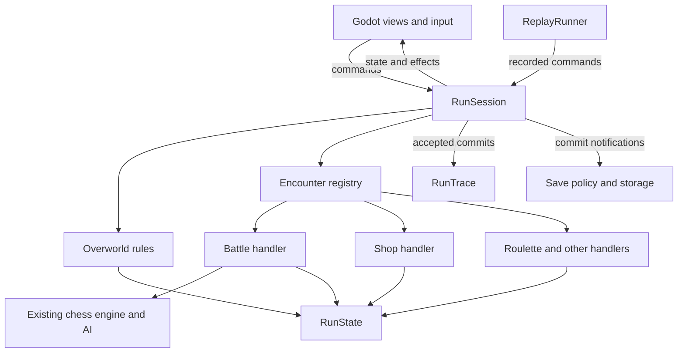

# Roguelike run architecture

Status: foundation and first playable slice implemented, 2026-11-23. The contracts below guide future gameplay systems.

Content integration, 2026-11-25: battle snapshot v2 preserves the M3 engine's per-side clock adjustments, banked extra turns, and accepted-action history. New runs use `engine-content-v2`; pre-M3 traces/saves require the older build and are rejected explicitly, with migrations still deferred. These engine clock adjustments do not define a run-level HP clock or wall-clock gameplay policy.

The current implementation adds `RogueChess.Runs`, versioned command traces and complete battle snapshots, atomic command execution, deterministic AI, policy-driven battle undo, save/load, and debug replay/seek. The Godot host opens a configured 5x5 overworld with the existing bartender scene and a generated street battle. `run/prototype.json` supplies fixture content; generation algorithms, inventory gameplay, and global-clock rules remain deferred.

Current choices: inventory/encounter codecs use `StatePayload` with kind/version/data; battle undo stores full prior decision positions in encounter state; each save writes a full trace plus a checkpoint; debug seek currently replays from sequence zero. These favor correctness and inspectability. Save timing is selectable in Run tools, defaulting to overworld return, and preferences survive restarts. Undo is free in the playable fixture, with paid-policy behavior covered by tests.

Initial diagnostic profile (Windows, Debug, 12 player turns with a 1,000-node test AI): 13 recorded commands produced a 5,407-character trace and a 73,466-byte save; writing took 8 ms, restoring 41 ms, and replaying 282 ms. This is a small test fixture, not a production performance target. The repeatable profile test is in `tests/RogueChess.Runs.Tests/RunTests.cs`.

## 1. Contract

A run can be reconstructed from its seed, starting inputs, compatible rules/content, and ordered state-changing player commands. The same execution path serves live play, imported-run replay, and debugging.

Agreed requirements:

- Assign a seed when starting a run. Invoke world generation then; its algorithms and any later adaptation are separate systems.
- Track an extensible inventory object. Encounters may affect it in different ways; this layer does not define its contents or carryover rules.
- Keep an append-only run trace. Record accepted commands that affect authoritative game state, including gameplay undo. Exclude rejected commands, no-ops, menus, selection, camera movement, and other presentation interactions.
- Retain decision duration as metadata. It does not currently affect simulation.
- Derive AI moves, offered items, and other automatic consequences during replay. They are not additional authoritative trace entries.
- Version the trace. Require compatible simulation/content initially; migrations are future work.
- Support both saving on return to the overworld and saving after every accepted command. Choose the default after measuring representative runs.
- Select coded encounter implementations through configuration, supplying their parameters. A universal encounter scripting language is unnecessary.
- Support debug reconstruction at earlier points. Playing a new branch of an imported run is deferred.

Permanent unlocks, inventory rules, generation algorithms, and global-clock gameplay are outside this implementation. The likely overworld is a chessboard with king-like movement and encounters entered by capture; the coordinator must not assume a forward-only branching graph.

## 2. Layers and ownership

Add a pure C# `RogueChess.Runs` project referencing `RogueChess.Engine`. The Godot project references both. Keep the existing engine independent of run progression and Godot.



`RunSession` is the single authority for a live run. It owns current state, the trace, and execution coordination. It validates routing, executes commands, settles automatic consequences, commits transitions, and exposes read-only state to presentation. It delegates gameplay rules to handlers rather than accumulating battle, shop, and event logic itself.

`RunState` contains the simulation data:

- Current phase: overworld, encounter, or ended. A battle's deployment/reward steps can be encounter substates.
- World state: player location, encounter instances, completion/reveal state, and any generation or adaptation data.
- Inventory state: a typed object owned by the inventory system, with no prescribed item categories.
- Active encounter: stable instance ID, kind, configuration reference, and encounter-specific state.
- RNG stream states and deterministic ID counters.
- Undo metadata needed by gameplay rules, including eligible restoration points and any costs that must survive a gameplay undo.

All future-behavior-affecting mutable data must be reachable through this state or reconstructible from the trace. Scene nodes, handlers, cached AI agents, and animations must not secretly own gameplay state. Definitions/configuration are immutable for the duration of a run.

Inventory and encounter payloads use their own typed models in memory. At the persistence boundary, registered codecs convert them to versioned data using stable type IDs. Require complete capture/restore and deterministic serialization; do not serialize arbitrary CLR object graphs or Godot objects.

## 3. Initialization and world generation

`StartRun(seed, resolvedConfiguration, startingInputs)` creates a trace header, invokes an `IRunInitializer`, and reaches the first point waiting for player input. This is sequence zero. An automatically chosen seed is stored before generation begins.

The initializer delegates map and encounter generation to their future implementations. Tests and the first vertical slice can supply a small fixed world through the same contract. Generation produces the initial world and encounter data once. Later adaptation, if introduced, runs deterministically as a consequence of a command and becomes part of mutable world state.

Distinguish generating encounter content from instantiating its live handler. At run start, the generator can create its contents and parameters; on entry, the handler binds that generated instance to current run state. This leaves room for inventory-sensitive rules without prescribing them now. Scenes can load lazily without changing when simulation randomness is consumed.

Use stable, named RNG streams derived from the root seed, generator version, encounter instance ID, and purpose. Separate initial generation, individual encounters, and battle decisions. Persist stream state where randomness advances. Visual randomness has a separate source and never consumes simulation RNG.

## 4. Configured encounters

An encounter definition selects a registered `kind` and supplies validated parameters. A generated encounter instance has its own stable ID and state. Multiple instances may share a definition.

Illustrative definition, not a new config file:

```json
{
  "id": "alley-wheel",
  "kind": "roulette",
  "schemaVersion": 1,
  "parameters": {
    "wheelDefinitionId": "wheel.basic"
  }
}
```

`EncounterRegistry` maps `roulette` to a coded factory. That factory validates the payload and constructs a roulette handler with typed parameters. Battle, shop, and future kinds follow the same pattern. An elite encounter can be a battle configuration unless it needs distinct mechanics.

Each handler supplies these capabilities; exact C# signatures can follow the first implementation:

1. Initialize encounter state from a generated instance and current run context.
2. Validate and execute commands addressed to that encounter.
3. Advance deterministic automatic work until another player decision or completion.
4. Produce a completion result and any run/inventory changes.
5. Capture and restore its state through its registered codec.

These operations participate in the session's transaction. A handler may update the transaction's inventory through that system's API; it cannot mutate the committed inventory directly. This guarantees tracking without defining what an encounter is allowed to buy, remove, or transform.

The coordinator handles entry and completion exactly once. Completion, inventory changes, encounter status, and return to the overworld commit together. If the player must choose a reward, the handler remains in a waiting-for-choice substate until that command arrives.

Godot maps encounter kinds to presentation scenes separately. Configuration chooses registered implementations; imported data never names an arbitrary executable type to instantiate.

## 5. One command transaction

A command describes gameplay intent using stable IDs and typed parameters: move on the overworld, make a battle move, buy an offer, choose an event option, or undo. The session derives consequences and resource changes; the caller does not supply a replacement authoritative state.

For every command:

1. Verify the expected state revision, phase, encounter identity, and applicable gameplay rules.
2. Execute against an isolated working state. Initially, favor complete state copies/checkpoints for correctness; profile before introducing run-wide inverse-operation machinery. Existing engine make/unmake remains useful inside battles and AI search.
3. Resolve deterministic consequences, including AI responses, triggers, and encounter completion, until the next player decision or run end. Use deterministic work limits to detect a faulty infinite automatic sequence.
4. If rejected, failed, or unchanged, discard the working state. Do not append a command. RNG and ID allocation must also roll back. Return any rejection to the UI without adding it to the run trace.
5. Commit the new state and exactly one trace entry together in memory. Publish presentation effects and notify the save policy after the commit.

A user move and its automatic AI response form one committed transition. Presentation may animate their intermediate effects, but save/replay boundaries are settled decision points, independent of animation duration. Initial automatic work before the first input is resolved similarly from the run header.

Async AI work runs against isolated state. Cancelled or stale work cannot commit, and a wall-clock timeout must not publish a partially searched, timing-dependent choice. While a transition is pending, the previous committed state remains the recoverable state.

Two clicks on a purchase or encounter completion cannot commit twice: the second command must pass revision and state validation against the updated state. Serial command execution keeps authority simple.

Derived effects can describe captures, inventory changes, reveals, and rewards for the UI and debug tools. They can be regenerated during replay and optionally retained as diagnostic output; they are not a second source of truth.

## 6. Trace and deterministic replay

### Header

`RunTraceHeader` contains:

- Trace format version and command schema versions.
- Simulation, generator, and RNG algorithm versions, plus a content manifest/hash.
- Root seed, normalized starting inputs, and the resolved run/encounter/AI configuration needed for reconstruction.
- A run ID and creation timestamp as identity/diagnostic metadata, not simulation randomness.
- An initial state digest to verify sequence zero.

Store resolved configuration rather than relying on a mutable profile name such as `club`. A content hash identifies dependencies; it does not bundle old executable rules. Import requires compatible installed rules and content. Reject unsupported versions explicitly; never silently replay against today's changed balance. A future schema migration and a future simulation-compatibility migration are different problems.

### Entry

Each `RunCommandEntry` contains:

- Monotonically increasing sequence number.
- Command type/version, target context, and serialized parameters.
- Decision duration in integer milliseconds.
- Digest of authoritative state after the complete transition.

Encode 64-bit seeds/identifiers losslessly in the export format, for example as decimal strings. Use stable content IDs instead of object references, scene paths, or list positions that depend on registration order.

Decision duration is measured by the input adapter from input becoming available until command submission, using a monotonic timer. Invalid attempts and opening menus do not reset this measurement or create trace entries. Initially it describes the whole wait for the accepted command, including menu time; it is not a promise about future clock-charging rules. Metadata timing is excluded from simulation digests.

### Execution

`ReplayRunner` validates the header, recreates sequence zero, and submits entries in order through the same command executor. It uses recorded timing metadata rather than measuring replay speed. AI responses and generated offers are recomputed. At each boundary it compares the resulting digest and stops at the first divergence, reporting sequence, command, expected/actual digest, and available derived diagnostics.

Replay uses a separate session with external side effects disabled. It must not overwrite a live save or emit live-session analytics. Existing commands, including undo, remain part of replay order. Debug stepping and seeking do not append commands to the source trace.

### Determinism requirements

- All simulation randomness uses versioned seeded streams. Rejected actions, menus, animations, and unrelated encounters cannot advance the wrong stream.
- Deterministic iteration/tie-breaking, arithmetic, configuration resolution, and ID allocation are part of the contract. Seeded randomness alone is insufficient.
- AI uses fixed node/depth budgets. The current `TimeBudgetMs` cutoff must be disabled for replayable execution or replaced with failure handling that does not commit a timing-dependent move.
- Run-level code never reads wall time to decide an outcome. Future real-time mechanics must supply recorded time inputs explicitly.
- Verify behavior across supported builds/platforms with fixed traces. Do not claim cross-platform compatibility solely because the same seed was used.

Use a digest of a canonical full-state serialization, such as SHA-256. Include world/inventory/encounter state, RNG, ID counters, and undo-relevant state. Exclude presentation caches, trace timestamps, and the digest itself. The chess engine's Zobrist hash is optimized for equivalent search positions and does not cover every field needed to reconstruct a run.

## 7. Undo and debug rewind

The trace records what the player actually did, not only the surviving line of play:

```text
1  BattleMove A  -> state after A and its AI response
2  Undo         -> eligible prior battle state, with undo policy applied
3  BattleMove B  -> state after B and its AI response
```

All three entries remain. Replay performs A, the undo, and B. The sequence counter never moves backward. A successful gameplay undo changes authoritative state and is itself a command.

An `UndoPolicy` selects eligible earlier decision points and defines which state to restore and which adjustments to preserve/apply. The anticipated player scope is within a battle. The coordinator supplies current state and historical state without prescribing consumable categories or exact undo granularity.

Costs must not be refunded accidentally by snapshot restoration. If undo consumes an item, cumulative undo use must be represented outside the portion that gameplay undo restores, while still remaining inside serializable run state. Repeated undo to an earlier point must retain all applicable costs exactly once. This is a policy operation, not simply replacing the entire run with an old snapshot.

Start with complete decision-point snapshots or reconstruction from the trace for correctness. Gameplay history eligibility is explicit; the engine's transient inverse log is only an optimization. A save/load must retain or reconstruct eligible undo targets, even when the latest checkpoint is after those targets.

Debug rewind reconstructs the complete historical run into an isolated inspection session, including inventory and prior undo usage at that time. It neither consumes an item nor rewrites the original trace. Developer edits that need to be replayable must use explicit debug commands; unrecorded state mutation invalidates reproducibility. User-facing branching and takeover remain deferred.

## 8. Checkpoints, storage, and save policy

Separate three decisions:

- **Recording:** every accepted state-changing command is immediately appended in memory.
- **Checkpointing:** periodically capture full state at a known command sequence to accelerate reconstruction. Begin with initial state and encounter boundaries; profile additional intervals.
- **Persistence:** flush a consistent trace/checkpoint bundle according to the selected save policy.

Provide `AfterCommand` and `OnOverworldReturn` policies. Initialization and terminal run outcomes are explicit persistence points as well. The transition executor emits committed-boundary notifications; handlers do not write files themselves.

`IRunStore` saves/loads a versioned bundle: header, the complete command trace through sequence N, and optional checkpoints tied to their sequence and digest. Retain the full trace even when checkpoints make old commands unnecessary for normal loading; those commands are the debugging record.

For the first local implementation, write the complete bundle to a temporary sibling file, validate/close it, and atomically replace the prior save using the platform's supported mechanism. Keep a recoverable previous generation. A checkpoint must never claim a sequence beyond the durable trace. Incremental journaling/compression can follow measured size or latency concerns.

If saving fails, retain the committed in-memory state as dirty, expose the failure, and retry persistence without re-executing the command or re-granting rewards. Saving on overworld return intentionally leaves intervening actions vulnerable to process loss; saving after each command narrows that window. Neither policy saves half a transaction.

Loading restores a compatible checkpoint and replays the remaining commands. If the checkpoint cannot support an older eligible undo target, reconstruct that target from an earlier checkpoint or sequence zero. Saving during an encounter is therefore supported without requiring it as the default.

## 9. Existing code integration

- [GameState](../src/RogueChess.Engine/Core/GameState.cs) already supports deterministic battle state, RNG restoration, cloning, and in-memory make/unmake. Add explicit snapshot import/export covering all state: dead/off-board pieces, variables, globals, turn/ply, rules, RNG, and the next entity ID. Its existing clone intentionally clears inverse history; a snapshot is not a serialized undo stack.
- [Game.PlayTurn](../src/RogueChess.Engine/Resolution/Game.cs) remains the battle-resolution path. The run battle handler validates player moves against legal actions before calling it; `Accepted` currently reports resolution acceptance, not a complete authorization/legality check.
- [EncounterGenerator](../src/RogueChess.Engine/Encounters/EncounterGenerator.cs) can supply battle generation. Its convenience `Generate` method currently generates both armies anew, so it must not become a run-level inventory policy. Compose the appropriate lower-level generation/build functions when the inventory system is defined. Separate player/enemy placement randomness if future requirements need them to be independently stable.
- [AgentFactory](../src/RogueChess.Engine/AI/AgentFactory.cs) is an existing model for registered kinds plus configuration. Reuse it for battle AI, with resolved profiles and deterministic limits.
- [TurnTrace](../src/RogueChess.Engine/Resolution/Trace.cs) remains a derived battle-resolution explanation. The run command trace is a different abstraction and must not depend on human-readable trace text.
- [Sandbox](../sandbox/Sandbox.cs) remains a debug client. Extract/reuse its battle presentation through the run session instead of making the sandbox the run orchestrator. [The menu](../menu/main_menu.gd) will launch or resume a run through a Godot host that survives encounter view changes.

Presentation startup is separate from encounter simulation. `RunHost` requests scene resources for reachable encounters through Godot's threaded loader while the overworld is visible and retains loaded `PackedScene` resources for the host's lifetime. Entering first displays feedback, then waits without blocking for resources; node instantiation and `_Ready` still run on the main thread. A view-generation check discards superseded transitions. Loading failure offers a presentation retry without repeating the already-committed world command. Entry timings are logged separately from the run trace; GPU warmup and procedural scene construction require their own profiling.

Suggested organization:

```text
src/RogueChess.Runs/
  Core/           RunState, RunSession, command execution
  Encounters/     registry, handler contracts, battle adapter
  Generation/     initializer contracts, seeded streams
  History/        trace, replay, undo, checkpoint contracts
  Serialization/  versioned DTOs, codecs, canonical state digest
  Persistence/    storage contract, save policies
tests/RogueChess.Runs.Tests/
run/              Godot host, local storage adapter, presentation routing
```

## 10. Implementation order and acceptance criteria

1. **Session and trace foundation.** Add the pure C# project, extensible state codecs, deterministic initialization, command transaction, header/entries, and full-state digest. Use tiny fake inventory/encounter handlers to verify the contracts without deciding gameplay.
2. **Replay and persistence.** Add import/export, checkpoint restoration, both save policies, compatibility checks, and isolated replay/seek. Prove that a round trip and uninterrupted execution reach identical state.
3. **Battle adapter and undo.** Add engine snapshot serialization, deterministic AI execution, and policy-driven gameplay undo. Verify a trace containing a move, AI response, undo, and alternate move, including repeated non-refundable undo costs under a test policy.
4. **Config-driven run slice.** Wire a Godot host, a fixture overworld, and registered battle plus minimal fixture event handlers. Enter, complete, return, save, reload, and replay. Real generation, inventory gameplay, and event content can then be implemented behind the tested boundaries.

Required verification includes: replay equivalence across independent sessions; rollback of invalid/no-op commands including RNG/IDs; atomic completion and duplicate-input rejection; save/load inside an encounter; undo targets before a checkpoint; replay divergence diagnostics; unknown-version rejection; and failed-save recovery without duplicate effects. Include a test that the run assembly has no Godot dependency. Test deterministic AI budgets explicitly.

Profile representative trace size, checkpoint size, accepted-command overhead, disk-write latency, and replay/seek time before choosing default save/checkpoint frequency. This architecture leaves those policies adjustable without changing encounter code.

## 11. Reserved extension: a global clock

Keep decision-duration metadata now. It is observational, not an HP or timeout policy.

If elapsed time later changes inventory/HP or ends a run, time becomes an explicit simulation input. Duration attached to player commands can describe time spent before a move, but cannot alone represent a timeout when the player never makes another move. That feature must define recorded time/expiry inputs, pause behavior, and undo treatment, and version the trace accordingly. Replay must never consult its own wall clock to reproduce that outcome.
